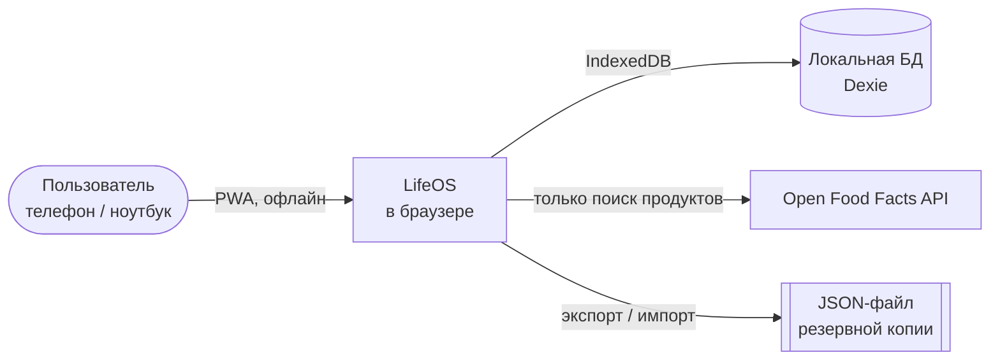
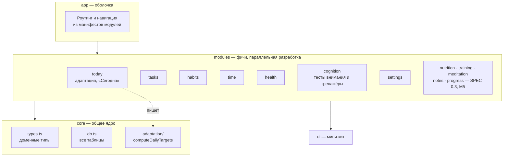
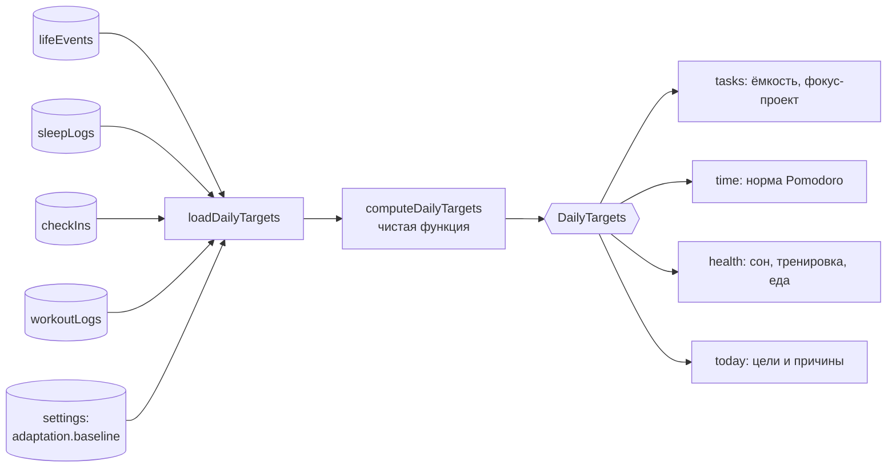

# Архитектура LifeOS

Короткая карта системы. Почему она такая — в [ADR](adr/).

## Контекст



Сервера нет. Все данные — на устройстве пользователя ([ADR-0001](adr/0001-local-first-pwa.md)).

## Модульный монолит



Правила, которые проверяет CI (`npm run deps`, файл `.dependency-cruiser.cjs`):

| Правило                   | Смысл                                                         |
| ------------------------- | ------------------------------------------------------------- |
| `no-cross-module-imports` | модуль не импортирует другой модуль; обмен данными — через БД |
| `core-is-independent`     | ядро не знает о модулях, оболочке и UI                        |
| `ui-is-independent`       | UI-кит не знает о модулях и БД                                |
| `logic-is-pure`           | `modules/*/logic/` и движок адаптации — без React и без БД    |
| `no-circular`             | нет циклических зависимостей                                  |

## Внутреннее устройство модуля

```
src/modules/<id>/
  index.ts          манифест AppModule (маршрут, иконка, порядок в навигации, фоновый компонент Background)
  CLAUDE.md         владение, таблицы, ссылки на issues — читается агентом автоматически
  logic/            ЧИСТЫЕ функции: вычисления, правила, парсеры (+ *.test.ts рядом)
  data/             чтение/запись своих таблиц Dexie, хуки useLiveQuery
  components/       React-компоненты модуля
  <Name>Page.tsx    страница и вложенные маршруты
```

`Background` (необязательно) оболочка монтирует один раз на всех страницах, вне маршрутов: для работы,
которая идёт, пока открыт другой модуль (таймер Pomodoro модуля `time`). Он ничего не рисует или рисует маленький fixed-элемент.

Поток данных: **компонент → хук из `data/` → Dexie**; вычисления — **чистые функции из `logic/`**.
Это «функциональное ядро, императивная оболочка» ([ADR-0003](adr/0003-adaptation-as-pure-rules.md)):
всё, что можно ошибиться посчитать, тестируется без браузера и базы.

## Слой адаптации



`workoutLogs` нужны правилу «вчера тяжёлая тренировка (RPE ≥ 8) → сегодня не выше умеренной»; полный список
правил — [SPEC, раздел 5.4](SPEC.md).

Модули только **читают** `DailyTargets`. Новое правило добавляется в `core/adaptation/rules.ts`
с тестом — ни один модуль не меняется.

## Владение таблицами

| Модуль    | Пишет в таблицы                                                                       |
| --------- | ------------------------------------------------------------------------------------- |
| tasks     | `projects`, `tasks`                                                                   |
| habits    | `habits`, `habitLogs`                                                                 |
| time      | `timeCategories`, `timeEntries`, `settings` (`time.*`, например `time.pomodoro`)      |
| health    | `sleepLogs` (через `core/logging/saveSleep`), `foods`, `mealLogs`, `workoutLogs`      |
| today     | `lifeEvents`, `checkIns`, `settings` (`adaptation.*`); сон — только через `saveSleep` |
| cognition | `cognitiveTests`                                                                      |
| settings  | `settings` (остальные ключи), импорт всех таблиц через `core/backup`                  |

Ключ `time.pomodoro.running` = `{ phase, startedAt, endsAt }` (мс) — идущая фаза Pomodoro; ключа нет, когда таймер
не идёт. Пишет `time`, читают все (например, «Сегодня»); `endsAt <= now` — не идёт.

Таблица `settings` делится по префиксу ключа: модуль пишет только свои ключи `<модуль>.*` (`adaptation.*` — today,
`time.*` — time, `nutrition.*` — nutrition после SPEC 0.3), остальные ключи — модуль `settings`.

Читать можно любые таблицы. Общий путь записи для таблицы, которую заполняют два модуля, живёт в `src/core/logging/`
([ADR-0007](adr/0007-shared-write-paths.md)): сейчас это только сон.

Чистое правило, которое нужно двум модулям одинаково, тоже живёт в ядре, а не копируется: расписание привычек
(`isDue`, неделя с понедельника) — `src/core/habitSchedule.ts`, им считают и «Привычки», и «Привычки: X из Y» на «Сегодня».

## Расширение по SPEC 0.3

[SPEC 0.3](SPEC.md) добавляет пять блоков и переносит два журнала. Таблицы и каркасы появляются контрактной
issue «каркасы блоков» (веха M5); до её слияния этих модулей и таблиц **нет**, писать в них нельзя.

| Модуль (план) | Будет писать в таблицы                                                                                               | Читает                               |
| ------------- | -------------------------------------------------------------------------------------------------------------------- | ------------------------------------ |
| nutrition     | `weightLogs`, `settings` (`nutrition.*`); после переноса — `foods`, `mealLogs`                                       | `sleepLogs`, `workoutLogs`, цели дня |
| training      | `programs`, `plannedSessions`; журнал — только через `core/logging/saveWorkout`                                      | `workoutLogs`, цели дня              |
| meditation    | `meditationSessions`                                                                                                 | цели дня                             |
| cognition     | `cognitiveTests`, `mindSessions` (новая)                                                                             | цели дня                             |
| notes         | `notes`                                                                                                              | `projects`, `lifeEvents`             |
| progress      | `xpEvents`                                                                                                           | все таблицы (только чтение)          |
| health        | `sleepLogs` через `saveSleep`; `workoutLogs` — только через `saveWorkout` (импорт из Health Connect / HealthKit, M7) | цели дня                             |

Второй общий путь записи — `saveWorkout()`: журнал тренировок заполняют `health` (импорт из Health Connect /
HealthKit) и `training` (ручная запись и выполнение плана).

Платформа: нативные возможности (будильник, датчики, уведомления, Health) доступны модулям только через
`src/core/platform.ts` ([ADR-0008](adr/0008-web-and-native-one-codebase.md)); флаги возможностей говорят,
что доступно на текущей платформе, модуль показывает объяснение вместо недоступной функции.

Навигация: при 12 блоках нижняя панель держит «Сегодня», закреплённые вкладки и «Все блоки»; манифест
`AppModule` получает группу блока (контрактная issue «навигация», веха M5).
