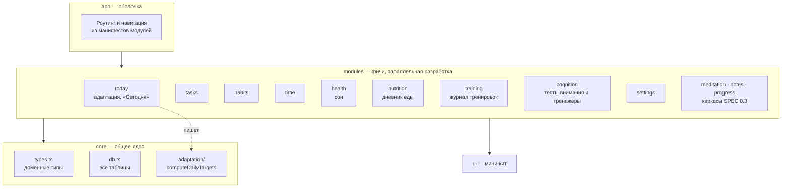
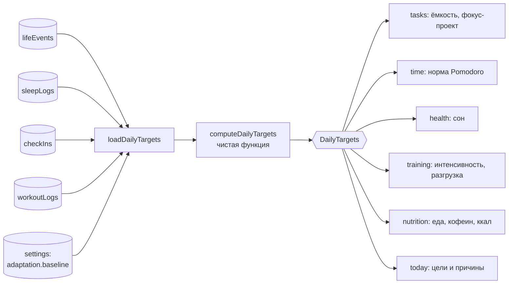

# Архитектура LifeOS

Короткая карта системы. Почему она такая — в [ADR](adr/).

## Контекст


Сервера нет. Все данные — на устройстве пользователя ([ADR-0001](adr/0001-local-first-pwa.md)).

## Модульный монолит



Правила, которые проверяет CI (`npm run deps`, файл `.dependency-cruiser.cjs`):

| Правило                        | Смысл                                                         |
| ------------------------------ | ------------------------------------------------------------- |
| `no-cross-module-imports`      | модуль не импортирует другой модуль; обмен данными — через БД |
| `core-is-independent`          | ядро не знает о модулях, оболочке и UI                        |
| `ui-is-independent`            | UI-кит не знает о модулях и БД                                |
| `logic-is-pure`                | `modules/*/logic/` и движок адаптации — без React и без БД    |
| `native-only-through-platform` | `@capacitor/*` импортирует только `src/core/platform.ts`      |
| `no-circular`                  | нет циклических зависимостей                                  |

## Внутреннее устройство модуля

```
src/modules/<id>/
  index.ts          манифест AppModule (маршрут, иконка, группа и строка смысла, закрепление navOrder, comingSoon, Background)
  CLAUDE.md         владение, таблицы, ссылки на issues — читается агентом автоматически
  logic/            ЧИСТЫЕ функции: вычисления, правила, парсеры (+ *.test.ts рядом)
  data/             чтение/запись своих таблиц Dexie, хуки useLiveQuery
  components/       React-компоненты модуля
  <Name>Page.tsx    страница и вложенные маршруты
```

`Background` (необязательно) оболочка монтирует один раз на всех страницах, вне маршрутов: для работы,
которая идёт, пока открыт другой модуль (таймер Pomodoro модуля `time`). Он ничего не рисует или рисует маленький fixed-элемент.

Поток данных: **компонент → хук из `data/` → Dexie**; вычисления — **чистые функции из `logic/`**.
Это «функциональное ядро, императивная оболочка» ([ADR-0003](adr/0003-adaptation-as-pure-rules.md)):
всё, что можно ошибиться посчитать, тестируется без браузера и базы.

## Слой адаптации



`workoutLogs` нужны правилу «вчера тяжёлая тренировка (RPE ≥ 8) → сегодня не выше умеренной»; полный список
правил — [SPEC, раздел 5.4](SPEC.md#54-правила-декларативные-расширяемые).

Модули только **читают** `DailyTargets`. Новое правило добавляется в `core/adaptation/rules.ts`
с тестом — ни один модуль не меняется.

Чтение целей — `core/adaptation/useDailyTargets.ts`: `useDailyTargets(date)` для одного дня и
`useDailyTargetsRange(from, to, whatIf?)` для диапазона до 31 дня — один живой запрос на весь диапазон, а не по запросу
на день (план тренировок на 2 недели, предпросмотр 10 дней события; `whatIf.event` — несохранённое событие формы).
Общие коэффициенты (`KCAL_PER_KG`, `DELOAD_FACTOR`, `LIGHT_DAY_RPE_LIMIT`) экспортирует `core/adaptation/rules.ts` —
модули не держат своих копий. «Сегодня», меняющееся в полночь без перезагрузки, — хук `useTodayKey()` из
`core/dates.ts` (#182).

## Владение таблицами

| Модуль     | Пишет в таблицы                                                                                                                                  | Читает (кроме своих)                 |
| ---------- | ------------------------------------------------------------------------------------------------------------------------------------------------ | ------------------------------------ |
| tasks      | `projects`, `tasks`; импорт истории — только через `core/logging/importTasks`                                                                    | цели дня                             |
| habits     | `habits`, `habitLogs`                                                                                                                            | цели дня                             |
| time       | `timeCategories`, `timeEntries`, `settings` (`time.*`, например `time.pomodoro`)                                                                 | `tasks`, цели дня                    |
| health     | `sleepLogs` (через `core/logging/saveSleep`); `workoutLogs` — только через `core/logging/saveWorkout` (импорт из Health Connect / HealthKit, M7) | цели дня                             |
| today      | `lifeEvents`, `checkIns`, `settings` (`adaptation.*`); сон — только через `saveSleep`                                                            | все таблицы (сводка, инсайты)        |
| cognition  | `cognitiveTests`, `mindSessions`                                                                                                                 | цели дня                             |
| settings   | `settings` (остальные ключи), импорт всех таблиц через `core/backup`; история Todoist — через `importTasks`, Sleep Cycle — через `saveSleep`     | все таблицы (экспорт)                |
| nutrition  | `weightLogs`, `settings` (`nutrition.*`), `foods`, `mealLogs` (дневник еды, #107)                                                                | `sleepLogs`, `workoutLogs`, цели дня |
| training   | `programs`, `plannedSessions`, `workoutLogs` (журнал — только через `core/logging/saveWorkout`, #107)                                            | цели дня                             |
| meditation | `meditationSessions`                                                                                                                             | цели дня                             |
| notes      | `notes`                                                                                                                                          | `projects`, `lifeEvents`             |
| progress   | `xpEvents`                                                                                                                                       | все таблицы (только чтение)          |

Ключ `time.pomodoro.running` = `{ phase, startedAt, endsAt }` (мс) — идущая фаза Pomodoro; ключа нет, когда таймер
не идёт. Пишет `time`, читают все (например, «Сегодня»); `endsAt <= now` — не идёт.

Таблица `settings` делится по префиксу ключа: модуль пишет только свои ключи `<модуль>.*` (`adaptation.*` — today,
`time.*` — time, `nutrition.*` — nutrition), остальные ключи — модуль `settings`.

Читать можно любые таблицы. Общий путь записи для таблицы, которую заполняют два модуля, живёт в `src/core/logging/`
([ADR-0007](adr/0007-shared-write-paths.md)): `saveSleep()` (сон: health и утренний поток today), `saveWorkout()`
(тренировки: training — ручная запись и выполнение плана, health — импорт из Health Connect / HealthKit) и `importTasks()`
(задачи и проекты: tasks пишет напрямую, импорт истории из settings — только через него).
Общее правило имени проекта — `src/core/projectNames.ts`.

Чистое правило, которое нужно двум модулям одинаково, тоже живёт в ядре, а не копируется: расписание привычек
(`isDue`, неделя с понедельника) — `src/core/habitSchedule.ts`, им считают и «Привычки», и «Привычки: X из Y» на «Сегодня».
Словарь стартовых упражнений и их групп мышц (`MuscleGroup`) — `src/core/exercises.ts`, `muscleGroupsOf(name)`: читают training
(перенос пропущенных групп) и аналитика; расширяется только там. Поле `muscleGroups` у упражнений необязательное —
читай `e.muscleGroups ?? muscleGroupsOf(e.name)`.

## Расширение по SPEC 0.3

[SPEC 0.3](SPEC.md) добавляет пять блоков и переносит два журнала. Таблицы (Dexie v3) и каркасы модулей
`nutrition`, `training`, `meditation`, `notes`, `progress` созданы контрактной issue «каркасы блоков» (#105, веха M5):
маршруты работают и показывают «скоро»; на экране «Все блоки» они помечены «скоро» (`comingSoon: true`) до первой
полезной функции.
Типы — `src/core/types.ts` (раздел «SPEC 0.3, 5.6»), владение — таблица выше.

Платформа: нативные возможности (будильник, датчики, уведомления, Health) доступны модулям только через
`src/core/platform.ts` ([ADR-0008](adr/0008-web-and-native-one-codebase.md)); флаги возможностей говорят,
что доступно на текущей платформе, модуль показывает объяснение вместо недоступной функции.
`getCapabilities()` возвращает `alarms`, `backgroundSensors`, `healthImport`, `notifications`: на вебе все `false`,
на нативе — установлен ли плагин из `CAPABILITY_PLUGINS`; `getPlatform()` — `web`, `android` или `ios`.
В тестах натив мокается `mockNativePlatform('android', ['notifications'])` из `src/test/platform.ts`; после
каждого теста снова веб. Импорт `@capacitor/*` где-либо, кроме `platform.ts`, ломает `npm run deps`
(правило `native-only-through-platform`). Нативная оболочка — `android/` и `capacitor.config.ts`, сборка — README.
Напоминания (задача, привычка, отбой) — `scheduleReminder({ id, title, body?, at })` и `cancelReminder(id)` из
`platform.ts` (#128). `id` — `<модуль>:<id записи>` (`habits:…`, `sleep:bedtime`): повтор с тем же `id` заменяет
напоминание, удаление записи — отмена. На нативе — локальное уведомление через ОС (`@capacitor/local-notifications`,
приходит и при закрытом приложении, восстанавливается после перезагрузки); точное, если на Android разрешены
«Будильники и напоминания», иначе неточное с `limitation` (может опоздать до часа). На вебе — Notification API (на
Android Chrome через service worker), пока открыта вкладка (`limitation`); после перезагрузки таймеры теряются. Поэтому модуль
заново планирует свои напоминания при старте на любой платформе (тот же `id` заменяет). Результат всегда статус: без разрешения — `denied`, без поддержки
— `unsupported`, отказ системы — `failed`, у каждого `hint` для показа. В тестах — `mockLocalNotifications()` из
`src/test/platform.ts`.
Ночные датчики (#140) — `startNightSensing()` / `stopNightSensing()` / `isNightSensingActive()`, утром
`readNightSamples()` и после сохранения `clearNightSamples(upTo)` (последняя сохранённая минута) из `platform.ts`.
На Android — своя служба переднего плана (`android/…/NightSensingService.java`, плагин `SleepSensors`): акселерометр
и уровень шума с микрофона, раз в минуту агрегат `NightSample` (`src/core/types.ts`) в файл приложения (не больше
двух ночей, старые минуты уходят первыми); звук не записывается. `null` в поле — нет показаний (нет датчика,
микрофон занят), а не «неподвижно» или «тишина»; пустые минуты не пишутся, поэтому в буфере бывают пропуски, а ночь,
пересекающая полночь, переводится в `DateKey` модулем. Старт — только по действию пользователя при открытом
приложении (Android 14+ иначе не запускает службу с микрофоном); ОС может остановить службу ночью — тогда
`isNightSensingActive()` вернёт `false`. Без разрешения на уведомления (Android 13+) значок службы не виден в шторке,
но индикатор микрофона системы горит. На вебе и без плагина — `unsupported`, без микрофона — `denied` с объяснением.
Расчёт по минуте и политика буфера — чистые Java-классы `NightMinute` / `NightBuffer` с JUnit-тестами
(`android/app/src/test`, CI `android.yml`). Алгоритм фаз сна — в модуле `health`. В тестах — `mockNightSensors()` из
`src/test/platform.ts`.
Будильник (#139) — `setAlarm({ at, windowMin })`, `cancelAlarm()` и `onAlarmDismissed(listener)` (событие
`alarm:dismissed` с `dismissedAt` и `alarmAt`, возвращает отписку) из `platform.ts`. Будильник один: новый заменяет
прежний. На Android — свой плагин `Alarm` (`android/…/AlarmPlugin.java`): `AlarmManager.setAlarmClock` звонит при
закрытом приложении, после перезагрузки (ещё до разблокировки: хранилище будильника — device-protected) или
обновления ставится снова; звонит служба `AlarmRingingService` (звук
будильника, вибрация, полноэкранное уведомление с «Выключить», через 10 минут затихает без события). Смахнуть
уведомление — то же, что «Выключить». Разрешения: `USE_EXACT_ALARM` (Android 13+, будильник — основная функция
блока «Сон»; на Android 12 — `SCHEDULE_EXACT_ALARM`), служба типа `mediaPlayback` (играет звук будильника). Поверх блокировки звонок открывает
`AlarmActivity` (#233: время будильника и крупная «Выключить», тёмный экран, «Назад» не выключает); на Android 14+
без права на полноэкранные уведомления — только уведомление с «Выключить». Выключение
сохраняется в приложении и доходит до первого подписчика один раз, даже если приложение было закрыто. `windowMin`
(0–120, окно умного пробуждения из целей дня) хранится с будильником; пока выбора лёгкой фазы нет, будильник звонит
ровно в `at`, не раньше. Результат — статус с `hint`: прошедшее время или неверное окно — `failed`, без уведомлений
(Android 13+) или с выключенными «Будильники и напоминания» — `denied`, на вебе и без плагина (iOS сейчас) —
`unsupported`. Правила (хранение выключений, восстановление, окно) — чистый `AlarmPolicy` с JUnit-тестами. В тестах
— `mockAlarm()` из `src/test/platform.ts` (`dismiss()` — пользователь выключил звонок).
Импорт из хранилища здоровья (#141) — `requestHealthAccess()` (одно окно доступа к сну и тренировкам, по действию
пользователя), затем `readSleep(from, to)` / `readWorkouts(from, to)` из `platform.ts` (плагин `@capgo/capacitor-health`:
Health Connect на Android, HealthKit на iOS). Чтение само окно доступа не открывает: без доступа — `denied` с `hint`, на
Android кнопка «Открыть настройки» — `openHealthSettings()`. HealthKit не сообщает об отказе: после окна доступа чтение
на iOS всегда `ok`, а пустой результат несёт `hint`, где проверить доступ. Возвращаются ночи (`ImportedSleep`, по дню
подъёма; окно чтения — от полудня до полудня, неделями; дневной сон — отдельная запись с `main: false`) и тренировки
(`ImportedWorkout`, типы формы тренировок; `kcal` и `distanceM` на Android не приходят — для них нужны лишние права) из
`src/core/types.ts` с `externalId` и `sourceId`: одна ночь из двух приложений — две записи, повторное чтение — те же
id. Модуль `health` пишет через `saveSleep` / `saveWorkout`; тренировка с `sourceId` + `externalId` при повторном
импорте обновляется (индекс `[sourceId+externalId]`, Dexie v5, #215): поля импорта — дата, тип, длительность; RPE,
упражнения и заметка, введённые в приложении, остаются.
Больше ~2000 тренировок или 2000 отрезков сна за неделю — `failed` («выберите период короче»), а не тихая обрезка.
Сопоставление — чистые функции `src/core/healthImport.ts`. Из прав плагина в манифесте оставлены только `READ_SLEEP`
и `READ_EXERCISE` (CI `android.yml` это проверяет), `minSdk` — 26 (требование клиента Health Connect; сам Health
Connect есть с Android 9). Для iOS-оболочки понадобятся entitlement HealthKit и `NSHealthShareUsageDescription`;
политика конфиденциальности для экрана Health Connect — контент владельца (#214). В тестах — `mockHealthStore()` из
`src/test/platform.ts` (`hidesDenial` повторяет поведение HealthKit).
В `AndroidManifest.xml` намеренно выключены Auto Backup и перенос на новое устройство (`allowBackup="false"`,
`data_extraction_rules.xml`): IndexedDB с данными о здоровье не покидает телефон до облака (ADR-0009) и согласия.
Service worker PWA регистрирует `src/main.tsx` только на вебе (`src/app/serviceWorker.ts`): в нативной оболочке бандл
лежит в APK, и воркер отдавал бы старую версию после обновления приложения. Воркер, оставшийся от прежней сборки, новая
сборка снимает вместе с кэшем Workbox — со следующего запуска после обновления (первый запуск ещё отдаёт старый бандл).
На вебе регистрация та же, что делал скрипт плагина (`register('./sw.js')`), без автоперезагрузки страницы.

Навигация (#106): нижняя панель — «Сегодня», до трёх закреплённых вкладок (`navOrder`; сейчас задачи, привычки,
время) и «Блоки» → экран «Все блоки» с модулями по группам (`group`: план, тело, ум, знания, система) и строкой
смысла (`summary`). Открыт незакреплённый блок — подсвечены «Блоки». Настраиваемые закрепления — отдельная issue.
