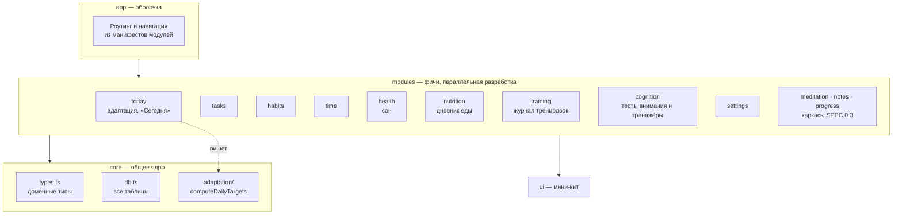
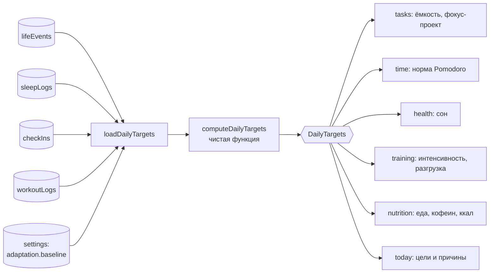

# Архитектура LifeOS

Короткая карта системы. Почему она такая — в [ADR](adr/).

## Контекст


Сервера нет. Все данные — на устройстве пользователя ([ADR-0001](adr/0001-local-first-pwa.md)).

## Модульный монолит



Правила, которые проверяет CI (`npm run deps`, файл `.dependency-cruiser.cjs`):

| Правило                   | Смысл                                                         |
| ------------------------- | ------------------------------------------------------------- |
| `no-cross-module-imports` | модуль не импортирует другой модуль; обмен данными — через БД |
| `core-is-independent`     | ядро не знает о модулях, оболочке и UI                        |
| `ui-is-independent`       | UI-кит не знает о модулях и БД                                |
| `logic-is-pure`           | `modules/*/logic/` и движок адаптации — без React и без БД    |
| `no-circular`             | нет циклических зависимостей                                  |

## Внутреннее устройство модуля

```
src/modules/<id>/
  index.ts          манифест AppModule (маршрут, иконка, группа и строка смысла, закрепление navOrder, comingSoon, Background)
  CLAUDE.md         владение, таблицы, ссылки на issues — читается агентом автоматически
  logic/            ЧИСТЫЕ функции: вычисления, правила, парсеры (+ *.test.ts рядом)
  data/             чтение/запись своих таблиц Dexie, хуки useLiveQuery
  components/       React-компоненты модуля
  <Name>Page.tsx    страница и вложенные маршруты
```

`Background` (необязательно) оболочка монтирует один раз на всех страницах, вне маршрутов: для работы,
которая идёт, пока открыт другой модуль (таймер Pomodoro модуля `time`). Он ничего не рисует или рисует маленький fixed-элемент.

Поток данных: **компонент → хук из `data/` → Dexie**; вычисления — **чистые функции из `logic/`**.
Это «функциональное ядро, императивная оболочка» ([ADR-0003](adr/0003-adaptation-as-pure-rules.md)):
всё, что можно ошибиться посчитать, тестируется без браузера и базы.

## Слой адаптации



`workoutLogs` нужны правилу «вчера тяжёлая тренировка (RPE ≥ 8) → сегодня не выше умеренной»; полный список
правил — [SPEC, раздел 5.4](SPEC.md#54-правила-декларативные-расширяемые).

Модули только **читают** `DailyTargets`. Новое правило добавляется в `core/adaptation/rules.ts`
с тестом — ни один модуль не меняется.

Чтение целей — `core/adaptation/useDailyTargets.ts`: `useDailyTargets(date)` для одного дня и
`useDailyTargetsRange(from, to, whatIf?)` для диапазона до 31 дня — один живой запрос на весь диапазон, а не по запросу
на день (план тренировок на 2 недели, предпросмотр 10 дней события; `whatIf.event` — несохранённое событие формы).
Общие коэффициенты (`KCAL_PER_KG`, `DELOAD_FACTOR`, `LIGHT_DAY_RPE_LIMIT`) экспортирует `core/adaptation/rules.ts` —
модули не держат своих копий. «Сегодня», меняющееся в полночь без перезагрузки, — хук `useTodayKey()` из
`core/dates.ts` (#182).

## Владение таблицами

| Модуль     | Пишет в таблицы                                                                                                                                  | Читает (кроме своих)                 |
| ---------- | ------------------------------------------------------------------------------------------------------------------------------------------------ | ------------------------------------ |
| tasks      | `projects`, `tasks`; импорт истории — только через `core/logging/importTasks`                                                                    | цели дня                             |
| habits     | `habits`, `habitLogs`                                                                                                                            | цели дня                             |
| time       | `timeCategories`, `timeEntries`, `settings` (`time.*`, например `time.pomodoro`)                                                                 | `tasks`, цели дня                    |
| health     | `sleepLogs` (через `core/logging/saveSleep`); `workoutLogs` — только через `core/logging/saveWorkout` (импорт из Health Connect / HealthKit, M7) | цели дня                             |
| today      | `lifeEvents`, `checkIns`, `settings` (`adaptation.*`); сон — только через `saveSleep`                                                            | все таблицы (сводка, инсайты)        |
| cognition  | `cognitiveTests`, `mindSessions`                                                                                                                 | цели дня                             |
| settings   | `settings` (остальные ключи), импорт всех таблиц через `core/backup`; история Todoist — через `importTasks`, Sleep Cycle — через `saveSleep`     | все таблицы (экспорт)                |
| nutrition  | `weightLogs`, `settings` (`nutrition.*`), `foods`, `mealLogs` (дневник еды, #107)                                                                | `sleepLogs`, `workoutLogs`, цели дня |
| training   | `programs`, `plannedSessions`, `workoutLogs` (журнал — только через `core/logging/saveWorkout`, #107)                                            | цели дня                             |
| meditation | `meditationSessions`                                                                                                                             | цели дня                             |
| notes      | `notes`                                                                                                                                          | `projects`, `lifeEvents`             |
| progress   | `xpEvents`                                                                                                                                       | все таблицы (только чтение)          |

Ключ `time.pomodoro.running` = `{ phase, startedAt, endsAt }` (мс) — идущая фаза Pomodoro; ключа нет, когда таймер
не идёт. Пишет `time`, читают все (например, «Сегодня»); `endsAt <= now` — не идёт.

Таблица `settings` делится по префиксу ключа: модуль пишет только свои ключи `<модуль>.*` (`adaptation.*` — today,
`time.*` — time, `nutrition.*` — nutrition), остальные ключи — модуль `settings`.

Читать можно любые таблицы. Общий путь записи для таблицы, которую заполняют два модуля, живёт в `src/core/logging/`
([ADR-0007](adr/0007-shared-write-paths.md)): `saveSleep()` (сон: health и утренний поток today), `saveWorkout()`
(тренировки: training — ручная запись и выполнение плана, health — импорт из Health Connect / HealthKit) и `importTasks()`
(задачи и проекты: tasks пишет напрямую, импорт истории из settings — только через него).
Общее правило имени проекта — `src/core/projectNames.ts`.

Чистое правило, которое нужно двум модулям одинаково, тоже живёт в ядре, а не копируется: расписание привычек
(`isDue`, неделя с понедельника) — `src/core/habitSchedule.ts`, им считают и «Привычки», и «Привычки: X из Y» на «Сегодня».

## Расширение по SPEC 0.3

[SPEC 0.3](SPEC.md) добавляет пять блоков и переносит два журнала. Таблицы (Dexie v3) и каркасы модулей
`nutrition`, `training`, `meditation`, `notes`, `progress` созданы контрактной issue «каркасы блоков» (#105, веха M5):
маршруты работают и показывают «скоро»; на экране «Все блоки» они помечены «скоро» (`comingSoon: true`) до первой
полезной функции.
Типы — `src/core/types.ts` (раздел «SPEC 0.3, 5.6»), владение — таблица выше.

Платформа: нативные возможности (будильник, датчики, уведомления, Health) доступны модулям только через
`src/core/platform.ts` ([ADR-0008](adr/0008-web-and-native-one-codebase.md)); флаги возможностей говорят,
что доступно на текущей платформе, модуль показывает объяснение вместо недоступной функции.

Навигация (#106): нижняя панель — «Сегодня», до трёх закреплённых вкладок (`navOrder`; сейчас задачи, привычки,
время) и «Блоки» → экран «Все блоки» с модулями по группам (`group`: план, тело, ум, знания, система) и строкой
смысла (`summary`). Открыт незакреплённый блок — подсвечены «Блоки». Настраиваемые закрепления — отдельная issue.
