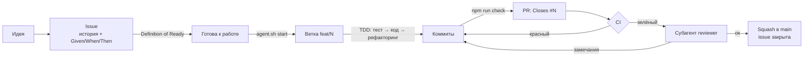

# Процесс разработки

Как работа идёт от идеи до `main`. Почему так — [ADR-0005](adr/0005-agent-workflow.md).

## Жизненный цикл задачи

## Definition of Ready (issue можно брать в работу)

- [ ] Формат истории: «Как пользователь, я хочу …, чтобы …».
- [ ] Критерии приёмки в формате Given / When / Then, каждый проверяем тестом.
- [ ] Метки `area:*`, `type:*`, `priority:*`, `size:*` и веха.
- [ ] Строка `Зависит от: #…` — все зависимости закрыты (`agent.sh next` проверяет сам).
- [ ] Размер ≤ L (до ~1 дня работы агента). Больше — разбить.

## Definition of Done (PR можно сливать)

- [ ] Каждый критерий приёмки покрыт тестом; имя теста повторяет критерий.
- [ ] `npm run check` зелёный локально (формат, типы, линт, границы модулей, тесты с покрытием, тесты скриптов, сборка).
- [ ] Для историй с UI: E2E-сценарий добавлен или расширен, `npm run e2e` зелёный; экран проверен на 360 px.
- [ ] Изменены только файлы своей зоны (`src/modules/<area>/`), либо issue помечена `contract`.
- [ ] Интерфейс на русском, есть пустые и ошибочные состояния, тёмная тема, кнопки ≥ 44 px.
- [ ] Субагент `reviewer` прошёл по diff, замечания исправлены или обоснованно отклонены в PR.
- [ ] CI на PR зелёный.
- [ ] Новые решения уровня архитектуры записаны как ADR.

## Метки

| Группа      | Значения                                                                                                                                                        |
| ----------- | --------------------------------------------------------------------------------------------------------------------------------------------------------------- |
| `area:`     | `core`, `tasks`, `habits`, `time`, `health`, `today`, `cognition`, `settings`, `infra`; с SPEC 0.3 — `nutrition`, `training`, `meditation`, `notes`, `progress` |
| `type:`     | `feature`, `bug`, `chore`, `contract` (меняет ядро — делать отдельным PR раньше фич, которые его ждут)                                                          |
| `priority:` | `P0` (сначала), `P1` (следующая очередь), `P2` (нужно решение владельца, аккаунт или контент — агенты берут только по команде)                                  |
| `size:`     | `S` (≤ 1 ч), `M` (≤ 3 ч), `L` (≤ 1 дня)                                                                                                                         |
| `status:`   | `in-progress`, `blocked`                                                                                                                                        |

Вехи: **M1 Фундамент** → **M2 Модули** → **M3 Адаптация** → **M4 Релиз MVP** → **M5 Курс 0.3 — контракты** →
**M6 Новые блоки** → **M7 Натив** → **M8 Облако и SaaS** ([SPEC 0.3](SPEC.md), раздел 4).

## Соглашения

- Ветка: `feat/<номер issue>`. Один PR — одна issue.
- Коммиты: [Conventional Commits](https://www.conventionalcommits.org/ru/) на английском —
  `feat(tasks): parse Russian relative dates`, `fix(core): …`, `test(health): …`.
- Заголовок PR (и squash-коммита в `main`, с суффиксом `(#PR)`) `agent.sh pr` берёт из **первого** коммита ветки:
  он описывает задачу, а последние обычно — правки по ревью. Если первый коммит не в формате `type(scope): …`
  (scope необязателен, как в Conventional Commits), заголовок — `feat(<area>): <заголовок issue>`; без метки `area:`
  PR не создаётся. У существующего PR заголовок не меняется. Тесты скрипта — `npm run test:scripts`
  (часть `npm run check`; нужен `jq`).
- Слияние: только squash, только с зелёным CI.
- Действия GitHub Actions — только по полному SHA коммита с комментарием версии
  (`uses: actions/checkout@<40 символов> # v4.4.0`; #296): тег и ветку владелец чужого действия может передвинуть на
  другой код, а он работает рядом с ключом подписи и секретами развёртывания. Проверка — `npm run lint:actions`
  (`scripts/check-actions-pinned.sh`, часть `npm run check` и CI) падает и называет файл и строку; локальные
  действия (`./…`) не проверяются, образ `docker://` — только с `@sha256:`. Шаг пишется блочной формой
  `- uses: …`: ключ `uses` в любой другой форме (flow-синтаксис, кавычки, escape, пробел перед двоеточием, явный ключ
  `?`, якорь/алиас) проверка считает ошибкой — каждый ключ она находит YAML-парсером (нужен `python3` с PyYAML, на
  ubuntu-latest он есть; без него, на файле не в UTF-8 или не по YAML и при любом сбое парсера проверка падает). SHA версии — `git ls-remote https://github.com/<owner>/<repo> 'refs/tags/<версия>*'` (у аннотированного
  тега — строка `^{}`). Проверка не знает, чей это SHA: GitHub находит коммит и в форке действия, поэтому ревьюер
  сверяет каждый новый SHA с тегом из комментария этой командой. Новые SHA вместе с комментарием предлагает Dependabot
  (экосистема `github-actions` в `.github/dependabot.yml`).

## Команды агента (`scripts/agent.sh`)

| Команда               | Что делает                                                       |
| --------------------- | ---------------------------------------------------------------- |
| `next <area>`         | следующая готовая issue дорожки с закрытыми зависимостями        |
| `show <N>`            | текст issue                                                      |
| `start <N>`           | метка `status:in-progress` + ветка `feat/N` от свежего `main`    |
| `pr <N>`              | push и PR с `Closes #N` (печатает номер PR)                      |
| `ci <PR>`             | ждёт CI и печатает результат                                     |
| `merge <PR>`          | squash-слияние зелёного PR, синхронизация локального `main`      |
| `block <N> <причина>` | метка `status:blocked` + комментарий, затем бери следующую issue |

В Claude Code то же доступно командами `/next <area>` и `/ship`.

## Модели и усилия

Сессию можно запускать на разных моделях: качество держат ревьюер и правила ниже. Модель меняется командой
`/model`, усилия — `/effort`; по умолчанию в проекте `effortLevel: high` (`.claude/settings.json`).

| Работа                                    | Модель            | Усилия                                 |
| ----------------------------------------- | ----------------- | -------------------------------------- |
| Контракты (`type:contract`) и ADR         | `fable` / `opus`  | `high` (`xhigh` — для контрактов ядра) |
| Сложная логика (адаптация, повторы, даты) | `opus`            | `high`                                 |
| Типовые CRUD и экраны                     | `sonnet`          | `medium`                               |
| Ревьюер (`.claude/agents/reviewer.md`)    | `opus`, закреплён | `high`, закреплены                     |

Модель и усилия ревьюера заданы в его frontmatter, и сессия не должна их переопределять (не передавать `model`
при запуске субагента), поэтому дорожки можно гонять на Sonnet без потери качества проверки. Переменные
`CLAUDE_CODE_EFFORT_LEVEL` и `CLAUDE_CODE_SUBAGENT_MODEL` в хуках и окружении не задавать — они перекрывают
и настройку проекта, и frontmatter.

## Если застрял

Не гадай молча и не обходи правила: `scripts/agent.sh block <N> "<что мешает и что нужно>"`,
затем `next` — к следующей задаче дорожки. Владелец разберёт заблокированные утром.
