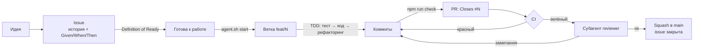

# Процесс разработки

Как работа идёт от идеи до `main`. Почему так — [ADR-0005](adr/0005-agent-workflow.md).

## Жизненный цикл задачи

## Definition of Ready (issue можно брать в работу)

- [ ] Формат истории: «Как пользователь, я хочу …, чтобы …».
- [ ] Критерии приёмки в формате Given / When / Then, каждый проверяем тестом.
- [ ] Метки `area:*`, `type:*`, `priority:*`, `size:*` и веха.
- [ ] Строка `Зависит от: #…` — все зависимости закрыты (`agent.sh next` проверяет сам).
- [ ] Размер ≤ L (до ~1 дня работы агента). Больше — разбить.

## Definition of Done (PR можно сливать)

- [ ] Каждый критерий приёмки покрыт тестом; имя теста повторяет критерий.
- [ ] `npm run check` зелёный локально (формат, типы, линт, границы модулей, тесты с покрытием, сборка).
- [ ] Для историй с UI: E2E-сценарий добавлен или расширен, `npm run e2e` зелёный; экран проверен на 360 px.
- [ ] Изменены только файлы своей зоны (`src/modules/<area>/`), либо issue помечена `contract`.
- [ ] Интерфейс на русском, есть пустые и ошибочные состояния, тёмная тема, кнопки ≥ 44 px.
- [ ] Субагент `reviewer` прошёл по diff, замечания исправлены или обоснованно отклонены в PR.
- [ ] CI на PR зелёный.
- [ ] Новые решения уровня архитектуры записаны как ADR.

## Метки

| Группа      | Значения                                                                                               |
| ----------- | ------------------------------------------------------------------------------------------------------ |
| `area:`     | `core`, `tasks`, `habits`, `time`, `health`, `today`, `settings`, `infra`                              |
| `type:`     | `feature`, `bug`, `chore`, `contract` (меняет ядро — делать отдельным PR раньше фич, которые его ждут) |
| `priority:` | `P0` (MVP), `P1` (следующий релиз), `P2` (позже)                                                       |
| `size:`     | `S` (≤ 1 ч), `M` (≤ 3 ч), `L` (≤ 1 дня)                                                                |
| `status:`   | `in-progress`, `blocked`                                                                               |

Вехи: **M1 Ядро и задачи** → **M2 Модули** → **M3 Адаптация** → **M4 Релиз MVP**.

## Соглашения

- Ветка: `feat/<номер issue>`. Один PR — одна issue.
- Коммиты: [Conventional Commits](https://www.conventionalcommits.org/ru/) на английском —
  `feat(tasks): parse Russian relative dates`, `fix(core): …`, `test(health): …`.
- Слияние: только squash, только с зелёным CI.

## Команды агента (`scripts/agent.sh`)

| Команда               | Что делает                                                       |
| --------------------- | ---------------------------------------------------------------- |
| `next <area>`         | следующая готовая issue дорожки с закрытыми зависимостями        |
| `show <N>`            | текст issue                                                      |
| `start <N>`           | метка `status:in-progress` + ветка `feat/N` от свежего `main`    |
| `pr <N>`              | push и PR с `Closes #N` (печатает номер PR)                      |
| `ci <PR>`             | ждёт CI и печатает результат                                     |
| `merge <PR>`          | squash-слияние зелёного PR, синхронизация локального `main`      |
| `block <N> <причина>` | метка `status:blocked` + комментарий, затем бери следующую issue |

В Claude Code то же доступно командами `/next <area>` и `/ship`.

## Если застрял

Не гадай молча и не обходи правила: `scripts/agent.sh block <N> "<что мешает и что нужно>"`,
затем `next` — к следующей задаче дорожки. Владелец разберёт заблокированные утром.
